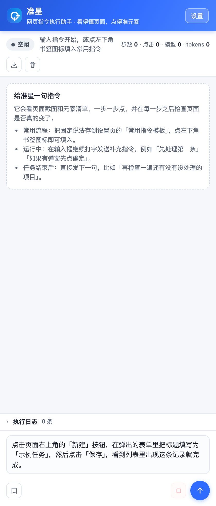
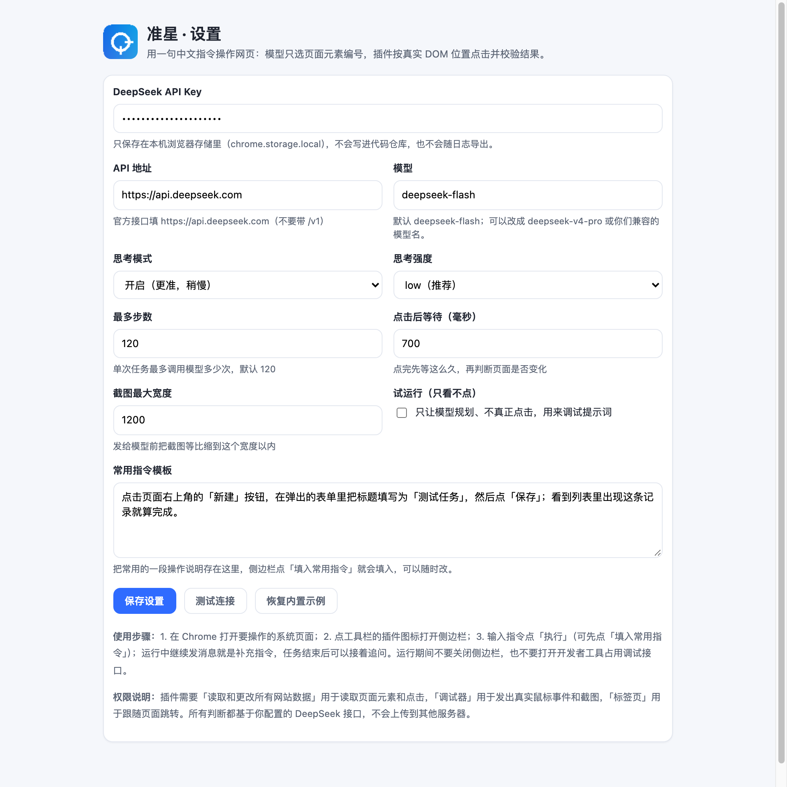

# Crosshair（准星）—— 用一句中文指令操作网页

> **准星**是一个通用的网页指令执行助手：你用一句中文说清楚要做什么，它看着页面截图和元素清单，一步一步点，并在每一步之后校验页面是否真的变了。
>
> 模型只负责"选哪个元素"，**不负责猜坐标**：插件按元素编号找到真实 DOM 元素、算出它当前的屏幕位置，再用浏览器调试接口发出真实鼠标点击。这样从根上避开了"模型看图估坐标 → 点偏"的问题。
>
> 交互参考常见浏览器自动化工具的 Playground 指令式体验（只是交互参考，准星是独立实现）：**自然语言指令 + 多轮对话**，运行中可继续发补充指令，任务结束后可以接着追问。
>
> **English:** Crosshair is a general-purpose Chrome extension that executes web tasks described in natural language. The model only picks DOM element IDs; the extension clicks the real element positions, verifies every action, and supports multi-turn follow-ups. Repo: [github.com/billyu01/crosshair](https://github.com/billyu01/crosshair)

---

## 1. 它解决什么问题

浏览器自动化里最常见的一类失败是"点偏"：模型在截图上估算一个坐标，换算或缩放稍微差一点，点击就落到按钮旁边的空白处；页面没反应，模型下一轮又给同一个坐标，于是反复点错。

准星不赌模型的坐标估计准不准：

```
旧方式：模型看图 → 给坐标 [x,y] → 换算/缩放误差 → 点偏 → 页面没反应 → 再点一次同样的错位置
准星：  截图 + 收集视口内可见元素清单（编号/文字/位置/尺寸/底色/字色/所在行）
        → 模型只返回 {"action":"click","element":12}
        → 插件按编号重新查 DOM 元素（防止元素被重建）→ 滚到视口中央 → 取最新矩形中心
        → 用浏览器调试接口发真实鼠标事件（isTrusted=true）
        → 等页面稳定，比较 URL + 页面文本签名：变了才算点成功
        → 连续无变化就把提示带回给模型换目标，不会在同一个错位置反复点
```

即使模型看错了，点击校验也会把错误暴露出来并让它改。

## 2. 功能

- **一句话指令**：侧边栏输入中文指令，点「执行」，插件自动规划并操作，直到判定完成。
- **多轮对话**：每轮的用户指令和助手结果写进对话记录；下一轮自动带上一轮上下文，可以直接说「继续」「再检查一遍」。
- **运行中补充指令**：任务跑着时继续发消息，不会打断当前动作，下一步以最高优先级交给模型。
- **点击可验证**：每一步点击后比较 URL 和页面文本签名，页面没变化会提示模型换目标；连续 6 次无变化自动停止。
- **防卡住**：元素清单会过滤掉整块容器，点击前再校验目标尺寸，避免点到"整个日历/整个面板"；同一个文字的元素连续点 6 次、或同一页面连续 18 步没跳转，会自动停下并说明原因，不会一直循环下去。
- **每步重新规划**：每一步都会对比上一步的页面元素，把变化明确告诉模型（例如「23」字色 #e60000 → #17803d、新增「提交」按钮），并要求它按新状态重新判断；每 5 步额外强制"重新读页面再决策"，避免照着旧记忆反复点已经完成的日期。
- **常见前端组件都能操作**：原生/自定义下拉框（selectOption 按选项文字选）、复选框/单选框/开关（click 并校验 checked）、图表（hover 看 tooltip、clickPoint 精确点数据点）、滑块/可拖拽组件（drag），以及输入框、按键、滚动、返回。
- **能输入文字、能按按键**：新增 `input` 动作（点击/聚焦输入框 → 清空旧内容 → 输入文字 → 可选回车）和 `pressKey` 动作（Enter/Escape/Tab/方向键）。输入框在元素清单里会标成 input/textarea 或 editable，搜索类任务可以直接输入关键词并回车。
- **主动识别任务完成**：不等模型说 done——页面可见文字出现「全部完成 / 已全部填报 / 没有待处理」等完成标志时立即自动结束；所有按钮/链接都变为禁用且持续两步时也会自动结束；提交/确认成功后的下一步会强制模型"先判断是否全部完成，再决定要不要继续"。
- **通用**：不内置任何具体业务逻辑，页面怎么操作完全由你的指令描述决定（表单录入、审批流、报表导出、批量处理……都只是不同的提示词）。
- **可复盘**：每一步都有日志（动作、原因、命中元素、模型耗时、tokens、页面是否变化），对话和执行日志都能导出 JSON。
- **配置简单**：DeepSeek 官方 API（默认模型 `deepseek-flash`），Key、模型、思考强度、步数上限、截图宽度都在设置页；Key 只存本机浏览器。

## 3. 指令与多轮对话怎么用

侧边栏底部是输入框，Enter 执行、Shift+Enter 换行。

- **第一轮**：输入指令，点「执行」；常用流程可以存到设置页的「常用指令模板」，侧边栏点「填入常用指令」一键填入。
- **运行中补充**（下一步生效，不打断当前动作）：
  - 「先处理第一条」
  - 「如果有弹窗，先点确定」
  - 「如果发现页面提示登录失效就停下」
  - 「跳过灰色的那一行」
- **任务结束后追问**：
  - 「再检查一遍还有没有没处理的项目」
  - 「继续把剩下的做完」
  - 「刚才那条保存成功了吗？」
- 对话记录最多 40 条，下一轮请求自动带最近 12 条上下文；上一轮的截图和元素清单不会重复塞回去，避免 token 越滚越大。
- 「清空」会同时清空对话和执行日志；「导出」把对话、运行日志和脱敏后的设置存成 JSON，方便复盘。

## 4. 安装

1. 打开 Chrome，地址栏输入 `chrome://extensions/`。
2. 右上角打开「开发者模式」。
3. 点「加载已解压的扩展程序」，选择本目录下的 `extension/` 文件夹；也可以先运行 `bash scripts/package.sh` 生成 `dist/crosshair-extension-*.zip`，解压后加载解压出来的目录。
4. 点插件图标 → 右上角「设置」→ 填 DeepSeek API Key（官方地址 `https://api.deepseek.com`，模型 `deepseek-flash`）→「保存设置」→「测试连接」。
5. 打开要操作的网页（保持该标签页在前台），点插件图标打开侧边栏，输入指令点「执行」；运行中可以在输入框继续发补充指令。

注意：

- 运行期间不要关闭侧边栏（引擎跑在侧边栏页面里）；不要打开开发者工具，否则调试接口会被占用。
- 插件需要「调试器」权限，Chrome 顶部会出现"正在调试此浏览器"的提示，这是正常现象。
- 首次运行会弹出权限确认，请允许访问目标站点。

## 5. 组件交互示例

这些能力都通过"一句中文指令"使用，例如：

```
把页面上的「城市」下拉框选成「上海」，勾选同意协议，鼠标悬停到折线图上查看提示，
再点击图中 10 月的数据点，最后把滑块拖到最右边。
```

- 下拉框：原生 `<select>` 直接说"选成 XX"；自定义下拉插件会自动点开再按选项文字点。
- 图表：描述要具体（"点击折线图右上角的数据点"），插件用截图坐标精确点击；需要数据提示时让它先"悬停"。
- 勾选框：直接说"勾选同意协议"；状态会用 checked/selected 校验。
- 拖拽：说清楚"把 A 拖到 B"，或用坐标描述起点终点。

## 6. 示例指令

准星不内置任何业务逻辑，下面这些只是"提示词"的写法示例：

```
点击页面右上角的「新建」按钮，在弹出的表单里把标题填写为「测试任务」，然后点「保存」；
看到列表里出现这条记录就完成。
```

```
在搜索框输入「本月销售数据」并回车，打开第一条结果，把页面上的销售额数字读出来，
最后在总结里说明环比是涨还是跌。
```

```
把「城市」下拉框选成「上海」，勾选同意协议，鼠标悬停到折线图上查看提示，
再点击图中 10 月的数据点，最后把滑块拖到最右边。
```

写指令时把"状态怎么表示、一次做几步、什么算完成、哪些不能点"说清楚，执行会更稳。

## 7. 目录结构

```
extension/          插件本体（chrome://extensions 里加载这个目录）
  manifest.json
  background.js     点图标打开侧边栏
  sidepanel.*       对话面板 + 运行引擎入口
  options.*         设置页
  lib/engine.js     主循环：截图 → 元素清单 → 模型 → 点击 → 校验
  lib/inventory.js  注入页面收集元素（编号、颜色、位置、所在行）
  lib/cdp.js        调试接口：截图、真实鼠标点击、原生弹窗
  lib/deepseek.js   DeepSeek 官方 API 客户端
  lib/planner.js    提示词与模型输出解析
docs/images/        界面截图
scripts/analyze-report.py  从自动化报告 HTML 里复盘坐标换算问题的脚本
scripts/package.sh         打包成 zip
```

## 8. 验证情况

插件在开发阶段用一套本地仿真页面做过端到端验证，覆盖：

- 完整循环任务（列表 → 操作 → 提交 → 返回 → 继续）跑通，没有误点已完成/不可点元素；
- 页面无变化检测、同页停留止损、反复点同一元素止损、误点大容器拦截；
- 多轮对话与运行中补充指令；
- 输入框输入、按键、下拉选择、勾选、图表悬停/坐标点击、拖拽；
- 真实 DeepSeek 模型整条链路跑通，任务完成后能自动识别完成状态并结束。

仿真页面和自动化测试属于本地开发资产，**不随本仓库提供**（避免携带特定业务系统信息）。

## 9. 界面截图

侧边栏（对话区：首轮指令 + 运行中补充指令 + 助手结果；下方是可折叠的执行日志和输入框）：



设置页：



## 10. 已知限制

- **通用插件的边界**：它按指令和页面视觉/元素清单行动，不针对某个业务系统写死逻辑；如果页面用 canvas 画关键控件（例如 canvas 日历），元素清单里没有对应元素，需要针对性适配。
- **暂不处理 iframe 内的元素**：目标页面主体在 iframe 里时，元素清单收集不到，需要额外适配。
- **侧边栏不能关**：引擎跑在侧边栏页面里，关掉侧边栏运行就会中断（日志会标记为"已停止"）。
- **真实业务页面建议先小步试跑**：第一次用建议把设置页「最多步数」调小到 20 左右，观察几轮确认元素识别正常后再放开。

## 11. 常见问题

- **补充指令什么时候生效？** 不打断当前这一步，下一步模型请求时以最高优先级带进去；运行中日志里能看到「收到补充指令」和「把用户补充指令交给模型」两条。
- **提示"目标标签页不是普通网页"**：先切到要操作的 http/https 页面再点开始。
- **提示"调试接口被占用"**：关掉该标签页的开发者工具后重试。
- **提示"API Key 里含有中文或全角字符"**：Key 复制错了，重新复制一次（只应包含字母、数字和连字符）。
- **需要在输入框里输入文字/搜索怎么办？** 直接说清楚即可，例如「在搜索框输入『黄金价格』并回车」。插件会把输入框识别出来并用 input 动作输入；如果页面是验证码/滑块（比如百度安全验证），插件不会破解，需要你手动过一下再继续，或者换必应/内网搜索。
- **任务其实已经全部完成，但插件还在点怎么办？** 这一版加了主动完成识别：①页面出现完成类文案立即 done；②所有按钮都禁用连续两步自动 done；③提交成功后下一步强制自检是否全部完成。如果目标页面完成时的提示文案没有被识别到，可以把原文发我，我加一条更精确的规则。
- **跑久了卡住、反复点已经填过的日期怎么办？** 插件现在有这些保护：①元素清单对比上一步的差异，把"某日期由红变绿/新增提交按钮"明确写进提示词，要求模型重新规划；②每 5 步强制一次"重新读页面再决策"；③清掉"整块日历"这类容器候选，点击前也会拒绝超大目标；④同一文字元素连点 6 次、同一页面 18 步没跳转就停止并给出原因。如果仍然出现，建议把设置页「思考模式」调成关闭或把「思考强度」降到 low，并把大任务拆小（例如先说「先处理第一条」）。
- **输入框内容看不全？** 已改成随内容自动增高（最高约窗口高度的 42%），超出后可滚动；底部按钮改成图标（悬停有文字提示），不再占一大行说明文字。
- **模型一直点不中 / 同一元素反复点**：看日志里"页面无变化"的提示；常见原因是元素被遮挡、页面还没加载完、或指令描述不够具体。可把步数上限调小先试跑，或先用「试运行（只看不点）」看模型规划是否合理。
- **费用**：每步一次模型调用，默认截图宽 ≤1200、最多 120 步。一个典型的循环类任务大约 30～40 步。
